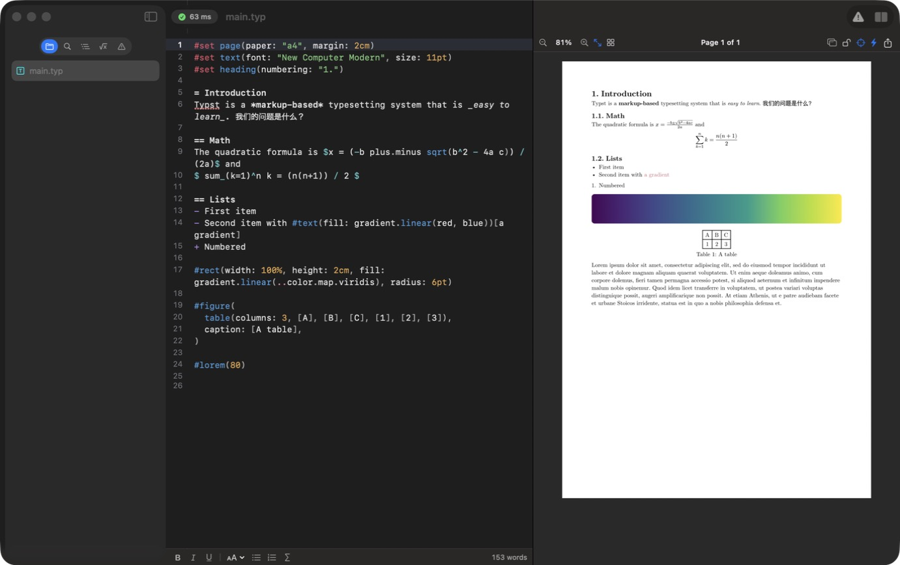

<p align="center">
  <br>
  <b>English</b> · <a href="README.zh-CN.md">简体中文</a>
</p>

# Inkwell

**A native macOS editor for [Typst](https://typst.app)** — a SwiftUI/AppKit app on top of a Rust core that embeds the Typst 0.15.1 compiler. Write on the left, see crisp vector pages update on the right as you type.



## Features

**Live preview**
- Pages are drawn as vectors straight from Typst's layout (no rasterizing), so they stay sharp at any zoom
- Incremental: only pages that changed are re-sent and redrawn
- Click anything in the preview to jump to its source; the preview follows your caret
- Zoom, fit-to-width (lockable), gallery mode, page jump, detachable preview window
- Lock the preview to one file, pause live preview, export PDF (or export in place)

**Editor**
- TextKit 2 editor with Typst syntax highlighting, line numbers and current-line highlight
- Autocomplete with snippets, hover documentation, ⌘-click go to definition
- Auto-closing brackets, list continuation, comment / duplicate line, bold / italic / underline / heading / list / math commands
- Spell checking limited to prose (code is never underlined)
- Vim key bindings (Normal / Insert / Visual) with relative line numbers
- Seven themes, font and size settings, animated caret, rounded selection, typing sounds
- Tabs, autosave, and a banner when a file changes on disk while you have edits

**Project**
- Sidebar: files, project-wide find & replace (containing / word / prefix / regex), outline, symbols, diagnostics
- Symbols: search every `sym` and `emoji` symbol, or **draw** one and let the [Detypify](https://github.com/QuarticCat/detypify) model recognize it
- BibTeX (`.bib`) entry editor, image and PDF viewer
- Typst Universe packages (auto-download, manage downloads), local package namespaces
- New project from any Typst Universe template
- Older Typst compilers (0.11–0.14) downloaded on demand for documents that need them
- The complete Typst documentation, bundled for offline use, with search and "Copy as Markdown"
- Interface in English, 简体中文, Deutsch, Français, Español, Italiano, Nederlands and Português

## Install

Download `Inkwell-<version>.dmg` from [Releases](../../releases), open it and drag Inkwell to Applications.

The app is ad-hoc signed and not notarized. The first time, right-click Inkwell → **Open**, or run:

```bash
xattr -dr com.apple.quarantine /Applications/Inkwell.app
```

Requires macOS 15 or later on Apple silicon.

## Build from source

Requirements: macOS 15+, Xcode 16+ command line tools (Swift 6), Rust stable.

```bash
scripts/build-core.sh        # Rust core → static library + Swift bindings
scripts/build-docs.sh        # optional: builds the offline docs from the Typst repository
scripts/bundle.sh release    # → build/Inkwell.app
scripts/package.sh           # → build/Inkwell-<version>.dmg and .zip
scripts/run.sh samples/demo  # launch on a folder
```

## Tests

```bash
cd core && cargo test --release   # compile, display list, completion, jumps, recognition, performance
scripts/selftest.sh               # drives the real editor and preview inside the app
scripts/selftest.sh network       # Typst Universe index and template projects
scripts/selftest.sh legacy        # downloads Typst 0.13.1 and compiles with it
```

## How it works

| Path | What |
| --- | --- |
| `core/` | Rust crate: Typst `World` (disk files + unsaved buffers + packages), page → binary display list encoder, IDE bridge (completion, tooltips, jumps), packages and templates, symbol recognizer. Exposed to Swift with UniFFI. |
| `app/` | Swift package: windows, editor, Core Graphics preview renderer, sidebar, settings, docs browser |
| `scripts/` | build, bundle, package, docs, icon, localization and test scripts |
| `docs/STATUS.md` | feature checklist |

The preview never rasterizes pages: the core serializes each laid-out page into a compact display list (glyph runs, paths, images, paints) and the app draws it with Core Graphics. Glyph outlines and images are fetched once and cached; gradients and tilings are pre-sampled by the core.

## Acknowledgements

Inkwell's design is inspired by [Edist](https://edist.app). It is an independent project and is not affiliated with or endorsed by Edist or Typst.

Built with [Typst](https://github.com/typst/typst) (Apache-2.0), [Detypify](https://github.com/QuarticCat/detypify) (MIT), [UniFFI](https://github.com/mozilla/uniffi-rs) (MPL-2.0), [tract](https://github.com/sonos/tract), ureq and rustls. The bundled documentation is © Typst GmbH and contributors (Apache-2.0).

## License

[Apache License 2.0](LICENSE)
